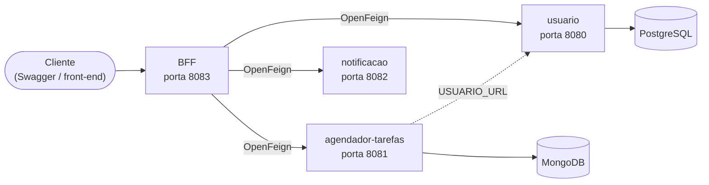

# BFF Agendador de Tarefas

**Backend for Frontend (BFF)** do sistema Agendador de Tarefas. É o ponto de entrada único do sistema: recebe as requisições do cliente e as encaminha, via **OpenFeign**, para os microsserviços de **usuário**, **tarefas** e **notificação**.

> 🎓 **Sobre o projeto:** desenvolvido durante o curso **JAVANAUTA**, o mesmo em que aprendi Spring Boot. Sistema desenvolvido em conjunto com a plataforma e a orquestração de todos os serviços com Docker Compose, os READMEs, ajustes de configuração foram feitos por minha conta visto que tive que adaptar para funcionar em versões mais novas.

---

## 🤔 O que é um BFF?

Um *Backend for Frontend* é uma camada intermediária entre o cliente (front-end, app, Swagger) e os microsserviços. Em vez de o cliente conhecer o endereço de cada serviço, ele fala só com o BFF, que:

- expõe **uma única API** para o cliente;
- **repassa as chamadas** para o serviço correto;
- mantém os detalhes internos (portas, URLs, bancos) escondidos do cliente.

## 🏗️ Arquitetura



### Os serviços

| Serviço | Porta | Banco de dados | Responsabilidade | Repositório |
|---|---|---|---|---|
| **BFF** (este) | 8083 | n/a | Ponto de entrada; encaminha as chamadas via OpenFeign | você está aqui |
| **usuario** | 8080 | PostgreSQL | Cadastro, login com JWT, endereço, telefone e consulta de CEP | [📖 usuario](https://github.com/BrunoSBelli/usuario) |
| **agendador-tarefas** | 8081 | MongoDB | Tarefas por usuário e status de notificação | [📖 agendador_de_tarefas](https://github.com/BrunoSBelli/agendador_de_tarefas) |
| **notificacao** | 8082 | n/a | Envio de e-mails | [📖 notificacao](https://github.com/BrunoSBelli/notificacao) |

Cada repositório tem o próprio README, com os endpoints e a configuração do serviço.

## 🔌 Comunicação entre os serviços (OpenFeign)

O **OpenFeign** permite chamar outro serviço HTTP declarando apenas uma **interface Java**. O Spring gera a implementação, e o código do BFF chama o método como se fosse local.

Exemplo ilustrativo (simplificado):

```java
@FeignClient(name = "usuario", url = "${usuario.url}")
public interface UsuarioClient {

    @GetMapping("/usuario")
    UsuarioDTO buscaUsuarioPorEmail(@RequestParam("email") String email,
                                    @RequestHeader("Authorization") String token);
}
```

> **[SUBSTITUA O EXEMPLO ACIMA POR UM TRECHO REAL DO SEU CÓDIGO, por exemplo uma das interfaces `...Client` do BFF.]**

O endereço de cada serviço vem de **variáveis de ambiente**, o que permite trocar o ambiente (local, Docker) sem alterar o código.

## ⚙️ Variáveis de ambiente do BFF

| Variável | Valor no Docker Compose | Descrição |
|---|---|---|
| `USUARIO_URL` | `http://usuario:8080` | Endereço do serviço de usuário |
| `AGENDADOR_TAREFAS_URL` | `agendador-tarefas:8081/tarefas` | Endereço do serviço de tarefas |
| `NOTIFICACAO_URL` | `notificacao:8082/email` | Endereço do serviço de notificação |

Dentro da rede do Docker Compose, os serviços se encontram pelo **nome** (`usuario`, `agendador-tarefas`, `notificacao`).

## ▶️ Como rodar (Docker Compose)

O [`docker-compose.yml`](docker-compose.yml) sobe **tudo de uma vez**: BFF, os três serviços, o PostgreSQL e o MongoDB.

### Pré-requisitos

- [Docker](https://www.docker.com/) com Docker Compose
- Os quatro repositórios clonados em pastas vizinhas

### Estrutura de pastas esperada

O Compose faz o *build* dos outros serviços por **caminhos relativos**, a partir da pasta deste repositório:

```yaml
build: ../../agendador_de_tarefas        # repositório agendador_de_tarefas
build: ../../usuario/usuario             # repositório usuario
build: ../../notificacao/notificacao     # repositório notificacao
```

Clone os repositórios de forma que esses caminhos existam, ou ajuste os `build:` do arquivo para onde você clonou.

### Subindo

```bash
docker compose up --build
```

Para parar e remover os contêineres:

```bash
docker compose down
```

### Endereços locais

| O quê | Endereço |
|---|---|
| **BFF** | http://localhost:8083 |
| Swagger do BFF | http://localhost:8083/swagger-ui/index.html |
| usuario | http://localhost:8080 |
| agendador-tarefas | http://localhost:8081 |
| notificacao | http://localhost:8082 |
| PostgreSQL | `localhost:5433` |
| MongoDB | `localhost:27017` |

> ⚠️ As credenciais do PostgreSQL (`admin` / `admin`) no `docker-compose.yml` são **apenas para desenvolvimento local**. Não use em produção.

## 🔐 Como usar a API (autenticação)

As rotas protegidas exigem um **token JWT**, emitido pelo serviço de usuário:

1. **Cadastre** um usuário
2. Faça o **login** e copie o token retornado
3. No Swagger, clique em **Authorize** e informe o token (ou envie o cabeçalho `Authorization: Bearer <token>` nas suas requisições)
4. **Cadastre** e **consulte** tarefas; o BFF repassa o token para os serviços

## 📖 Documentação dos serviços

| Serviço | Endpoints e configuração |
|---|---|
| usuario | [README do usuario](https://github.com/BrunoSBelli/usuario) |
| agendador-tarefas | [README do agendador_de_tarefas](https://github.com/BrunoSBelli/agendador_de_tarefas) |
| notificacao | [README da notificacao](https://github.com/BrunoSBelli/notificacao) |

A documentação interativa do BFF está no Swagger (link na seção de endereços locais).

## 🧰 Tecnologias

Java · Spring Boot · Spring Cloud OpenFeign · Maven · Docker · Docker Compose · GitHub Actions (workflow em `.github/workflows`) · Swagger/OpenAPI

## 🛣️ Próximos passos

- [ ] Testes unitários (JUnit e Mockito)
- [ ] *Healthchecks* no Docker Compose, para os serviços esperarem os bancos ficarem prontos

## 👤 Autor

**Bruno Souza Belli**: [GitHub](https://github.com/BrunoSBelli) · [LinkedIn](https://linkedin.com/in/bruno-souza-belli-508337235)
